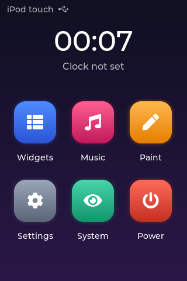

# n72-ui

A touch launcher for Linux on the iPod touch 2G (N72AP), built on
[LVGL](https://lvgl.io) 9.2.2 with its Linux framebuffer and evdev drivers.

- Home screen with a clock and six apps: LVGL's Widgets and Music demos,
  Paint (finger drawing), Settings (brightness), System (live stats) and Power.

- Buttons: Home returns to the launcher (the demos restart the process),
  Power turns the backlight off and on, the volume keys change the brightness.

## Build

LVGL goes in `../lvgl-src/lvgl` (`git clone -b v9.2.2 https://github.com/lvgl/lvgl`).
From the workspace root, in the `n72-build` container:

    docker run --rm -v "$PWD":/work -w /work n72-build sh n72-ui/build.sh

The static binary lands in `../n72-ui-build/n72-ui`;
`linux-s5l87xx/freemyipod/build-initramfs-n72.sh` installs it and starts it at
boot (add `noui` to the kernel command line to skip it).

## Environment

| Variable | Meaning |
| --- | --- |
| `N72_FB` | Framebuffer (default `/dev/fb0`) |
| `N72_TOUCH` / `N72_KEYS` | Event devices (default: found by name) |
| `N72_TOUCH_CAL` | `min_x min_y max_x max_y` raw touch range; swap a pair to flip an axis |
| `N72_TOUCH_SWAP` | `1` swaps the touch axes |
| `TZ` | Clock time zone (the initramfs sets it from `/etc/TZ`) |

## Kernel

Runs on the n72 branch of [kailashrs/linux](https://github.com/kailashrs/linux/tree/n72)
(simplefb display, Zephyr2 touchscreen, gpio-keys).

## License

MIT (see `LICENSE`). LVGL is MIT-licensed as well.
